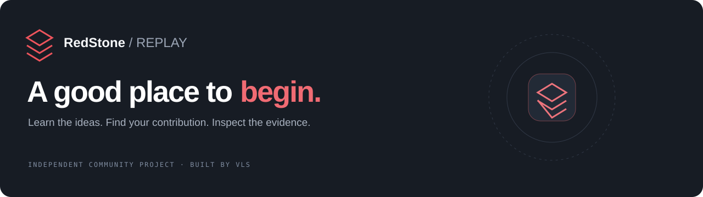
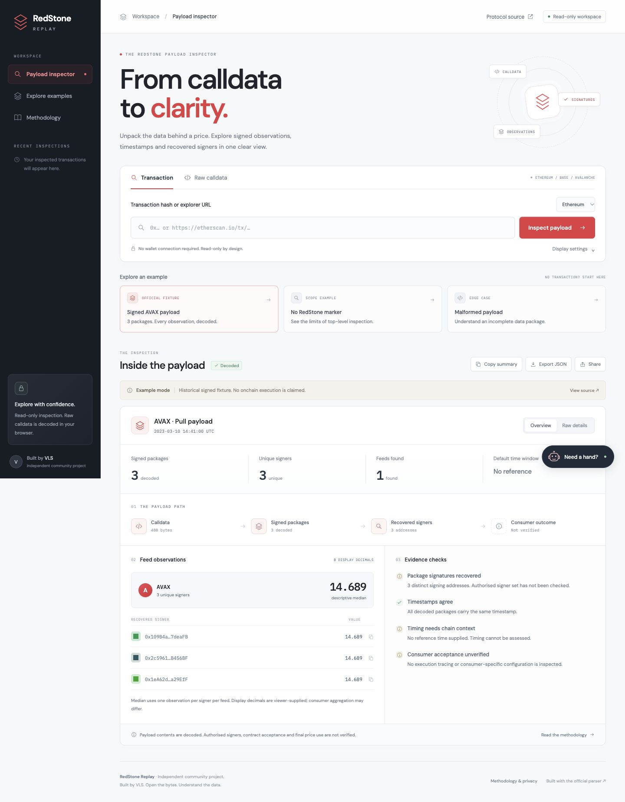

<div align="center">



**A clearer view of the data behind a price.**

Inspect RedStone pull payloads, follow signed observations, and understand what the bytes actually prove.

[**Open the live app ↗**](https://redstone-replay.vercel.app/) · [Community guide](docs/COMMUNITY_GUIDE.md) · [Contribute](CONTRIBUTING.md) · [Report an issue](https://github.com/vlsss12/redstone-replay/issues/new/choose)

[](https://github.com/vlsss12/redstone-replay/actions/workflows/ci.yml)
[](LICENSE)

</div>

## Why Replay exists

A transaction explorer can show you calldata. Working out what sits inside a signed oracle payload takes more effort: which feeds are present, who signed each package, and how the timestamps relate to the block.

Replay puts that evidence in one view. It is an independent community project by **VLS**, built for developers, researchers and community members who want to inspect the data themselves.



## Try it in a minute

1. Open [RedStone Replay](https://redstone-replay.vercel.app/).
2. Select **Signed AVAX payload** to load the official historical fixture. No wallet or RPC lookup is needed.
3. Follow **The payload path**, inspect **Feed observations**, then read **Evidence checks**.
4. Open **Raw details** for signatures, raw integers and metadata, or **Export JSON** to keep a report.

For your own transaction, paste a confirmed transaction hash or supported explorer URL and choose its network. To inspect bytes you already have, select **Raw calldata** and paste a `0x` value or a JSON object containing `input` or `data`.

**Need a hand?** The robot guide in the lower-right corner opens inputs, loads the sample and explains the results. It offers local guided help; it does not connect to an AI service.

→ [The community guide walks through each step, including common errors.](docs/COMMUNITY_GUIDE.md)

## What you can inspect

| Capability | What Replay shows |
| --- | --- |
| Transaction lookup | Confirmed public transactions on Ethereum, Base and Avalanche, using fixed RPC providers with fallback |
| Payload decoding | The official `@redstone-finance/protocol` parser, pinned to `1.0.0` |
| Signed observations | Feed IDs, raw numeric values, recovered signer addresses, timestamps and signatures |
| Per-feed summary | A descriptive median with one observation per signer per feed |
| Timing comparison | The default 180-second age / 60-second future window, against a block or supplied reference time |
| Reports | Downloadable JSON and share links for public transactions or the signed fixture |
| Interface | Responsive English workspace, input drafts preserved across tabs and a contextual robot guide |

## Read the evidence carefully

The project name describes making a payload readable. **This is a top-level calldata inspector, not an EVM execution replay or a security audit.**

- Recovering an address from a signature does **not** verify that a consumer authorises that signer.
- The displayed median does **not** establish the consumer’s aggregation, selected signer subset, threshold or final price.
- Display decimals are a viewer setting, not a verified feed specification. A numeric value is not necessarily a USD price.
- Timing checks use library defaults; deployed consumers may override them.
- A missing top-level marker does **not** prove a transaction did not use RedStone. Internal calls, stored push feeds and other delivery models are outside scope.
- Unsigned metadata is an untrusted label. The bundled AVAX example is a historical signed fixture, not a claimed onchain transaction.

[Architecture and inspection boundaries →](docs/ARCHITECTURE.md)

## Run locally

Use Node.js **22 or 24** and npm.

```bash
git clone https://github.com/vlsss12/redstone-replay.git
cd redstone-replay
npm ci
npm run dev
```

Open **http://127.0.0.1:4173**. Vite includes a local `/api/replay` middleware, so transaction lookup works in development too. No API keys, database or wallet setup are needed.

```bash
npm test        # Signed fixture, timestamps, input validation and RPC failover
npm run build   # Production frontend
```

`npm run preview` previews the built frontend only; it does not host the transaction API. Use `npm run dev` for local transaction lookup.

## Deploy your own copy

Import this repository into Vercel. The checked-in `vercel.json` configures the Vite build, static output and `api/replay.js` function. The deployed app needs no environment secrets.

A static-only host can serve the frontend and decode raw calldata, but transaction lookup also requires the API. See [deployment notes](docs/ARCHITECTURE.md#deployment).

## Privacy

Raw calldata is decoded in an isolated browser worker with a deadline and cancellation. Transaction lookup sends the public hash and network to the site API, which queries fixed public RPC providers. Recent transaction references are kept in localStorage. A transaction share URL contains its public hash and network; raw calldata is not embedded in share URLs. Exported reports contain decoded observations and any retrieved transaction context.

Hosting and RPC providers may keep routine request logs. Google Fonts is requested for typography. Replay does not ask for wallet connections, transaction signatures or private keys.

## Help the community

Useful contributions include a reproducible public transaction example, a clearer explanation of a confusing result, an accessibility improvement or a focused parser/API test. Include evidence and be precise about what has and has not been verified.

Start with [CONTRIBUTING.md](CONTRIBUTING.md), use the [issue templates](https://github.com/vlsss12/redstone-replay/issues/new/choose), or follow the [community contribution checklist](docs/COMMUNITY_GUIDE.md#make-a-useful-contribution).

## Sources and credits

- [Official payload-parsing example](https://github.com/redstone-finance/redstone-evm-examples/blob/main/scripts/parse-redstone-payload.js) — source of the historical AVAX fixture.
- [RedStone consumer base](https://github.com/redstone-finance/redstone-oracles-monorepo/blob/main/packages/evm-connector/contracts/core/RedstoneConsumerBase.sol) — context for consumer-side validation.
- [Default timing library](https://github.com/redstone-finance/redstone-oracles-monorepo/blob/main/packages/evm-connector/contracts/core/RedstoneDefaultsLib.sol) — default timing semantics.
- [Official protocol package](https://www.npmjs.com/package/@redstone-finance/protocol/v/1.0.0) — payload parsing and signer recovery.

Independent community software; not an official RedStone product. The project is [MIT licensed](LICENSE). Upstream notices are preserved in [THIRD_PARTY_NOTICES.md](THIRD_PARTY_NOTICES.md). Dependency advisory context is documented in [SECURITY.md](SECURITY.md). See the [focused review](docs/SECURITY_REVIEW.md) for hardening changes and verification limits.
