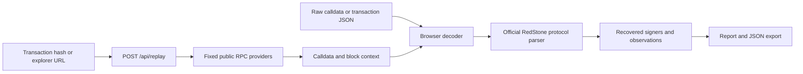

# Architecture and inspection boundaries

## Data flow

The frontend is vanilla JavaScript and CSS, bundled by Vite. User-supplied payloads are decoded in a terminable worker with an eight-second deadline. The bundled small fixture is decoded synchronously on startup. Inspections can be cancelled; transaction lookup has a 28-second client deadline. The same transaction lookup implementation is exposed through Vite middleware in development and a Vercel function in production.

## Files that matter

| Path | Responsibility |
| --- | --- |
| `src/engine.js` | Input normalisation, official parser integration, recovery and summaries |
| `src/reference.js` | Shared chain/explorer allowlists and input size limits |
| `src/payload-layout.js` | Bounded package/point count and physical layout checks before parsing |
| `src/decode.js`, `src/decode.worker.js` | Isolated browser decoding, deadline and cancellation |
| `src/main.js` | Workspace, report views, export/share controls and input state |
| `src/guide.js` | Local robot guide and contextual navigation |
| `src/fixtures.json` | Official historical signed AVAX example and source link |
| `src/style.css` | Responsive workspace and guide styling |
| `api/replay.js` | Fixed-provider JSON-RPC lookup and transaction/block consistency checks |
| `vite.config.js` | Build and development API middleware |
| `test/engine.test.js` | Offline fixture, boundary, validation and mocked RPC tests |
| `vercel.json` | Production static output, function duration and response headers |

## Parsing and aggregation

`analyzeCalldata` checks hex format and a 500 KB input limit, looks for the trailing pull-payload marker, validates physical field boundaries and count limits, then calls `RedstonePayload.parse` from `@redstone-finance/protocol@1.0.0`. Before recovering any signer, it rebuilds the parsed payload and requires a byte-for-byte match with the original input, including its prefix and unsigned metadata. Encodings changed by parser normalisation or point sorting are rejected rather than used to recover against a different digest. It then recovers addresses from signatures and extracts timestamps and feed data points.

Values are interpreted as unsigned integers. Display scaling is a viewer setting. Observations are grouped by feed and deduplicated case-insensitively by signer for the descriptive median; the first encountered observation for each signer is used. For even counts the exact average of the two middle values is retained, including a possible half-unit in `rawMedian`. BigInt arithmetic preserves this fraction in display scaling without floating-point rounding. These choices describe this inspector, not a deployed consumer’s aggregation.

Timing compares each package with a reference in whole seconds: a delta from `-60` through `180` is within the default window. No reference means no freshness verdict. The timestamp reference for a retrieved transaction is its block timestamp.

## Transaction lookup

Only Ethereum, Base and Avalanche are supported. Explorer hosts and RPC providers are fixed allowlists, not user-supplied endpoints. Lookup checks chain ID, transaction hash, receipt transaction/block hashes and the retrieved block hash. Public provider consistency is not cryptographic proof or independent chain verification.

The function uses two RPC endpoints per chain with fallback. An 11-second deadline per provider covers requests and response-body reads, RPC responses are capped at 2 MB, and input payloads are capped at 500 KB. Receipts and blocks must agree on block number, hash and transaction identity. Requests have timeouts; pending transactions, excessive input and unavailable providers return explicit errors. There is no wallet signing, database or stored transaction history on the application server.

## Trust boundaries

The inspector does not read the consumer’s authorised signer set or configuration, verify the selected threshold, simulate execution, trace internal calls, establish downstream price use or independently verify feed decimal conventions. Metadata is unsigned and untrusted. A missing marker is not evidence of no RedStone use.

The exported report includes these limits. Avoid building a security or trading verdict solely from this report.

## Deployment

The live app runs at [redstone-replay.vercel.app](https://redstone-replay.vercel.app/).

For a separate deployment, import the repository into Vercel. `vercel.json` selects Vite, runs `npm run build`, serves `dist/` and deploys `api/replay.js`. No environment secrets are required.

For local work use `npm run dev`; it serves the API middleware. `npm run preview` serves only the built frontend. A generic static host can support raw-calldata inspection but needs a separately hosted compatible API for transaction lookup.

## Verification

The checked-in test suite runs offline against the official fixture and mocked RPC responses. It covers recovered addresses, timestamp boundaries, display scaling, malformed input, size limits, the explorer allowlist and RPC chain failover. CI runs the suite and a production build on Node 22 and 24. This is functional validation, not a security audit.
