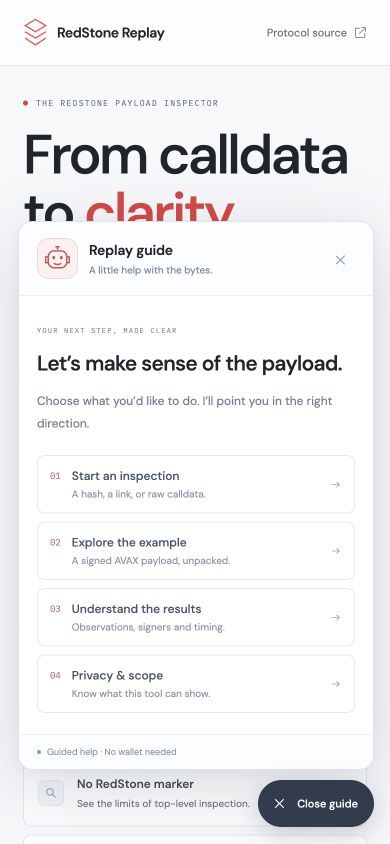

# The community guide to RedStone Replay

[Open Replay](https://redstone-replay.vercel.app/) · [Project overview](../README.md) · [Contribute](../CONTRIBUTING.md)

You do not need a wallet or coding experience to explore the example. Start with the bytes, follow the observations, and keep the boundaries of the evidence in view.

## New to RedStone?

Start with the [Field Guide](https://redstone-replay.vercel.app/community/). Choose your goal, available time and interest to get a short learning route. Try a lesson, move the invented observations, read a source-linked announcement and prepare a contribution in your own words. The robot in the lower-right corner can take you to each activity.

[Full Field Guide walkthrough and privacy details →](FIELD_GUIDE.md)

The rest of this page covers the payload inspector when you are ready to explore signed data.

## 1. Start with the signed example

Open the app and select **Signed AVAX payload** under **Explore an example**. This historical fixture comes from the official RedStone parsing example.

You should see:

| Field | Expected fixture result |
| --- | --- |
| Feed | `AVAX` |
| Signed packages | `3` |
| Unique recovered signers | `3` |
| Payload timestamp | `2023-03-10 14:41:00 UTC` |
| Display decimals | `8` by default |
| Descriptive median | `14.689` with that display setting |
| Default time window | `No reference` |

The example intentionally does not pretend to be current. Its old timestamp is useful for learning the format. It has no transaction block context and no freshness verdict until a reference time is supplied through raw-calldata inspection.

## 2. Inspect your own transaction

1. Choose **Transaction**.
2. Paste a confirmed transaction hash, or a transaction URL from Etherscan, Basescan, Snowtrace or Avalanche Routescan.
3. Select Ethereum, Base or Avalanche when using a bare hash. A supported explorer URL determines the network from its hostname.
4. Select **Inspect payload**.
5. Read the report. A marker-free result is still useful: it states that this inspector did not find a supported top-level payload.

A pending transaction needs to be included in a block before Replay can inspect it with block context. Public RPCs can be rate-limited, so a lookup failure is not evidence that a transaction is invalid.

## 3. Inspect raw calldata

Select **Raw calldata** and paste either an even-length `0x` hexadecimal string or a transaction JSON object:

```json
{
  "input": "0x..."
}
```

The snippet shows the shape only; replace `0x...` with actual calldata. A `data` field is also accepted. Raw bytes are decoded locally in a browser worker. Inspection accepts up to 500 KB of calldata, 500 packages and 4096 observations; numeric values are limited to 32 bytes. You can cancel an inspection, and decoding stops if its time limit is exceeded.

Open **Display settings** to set display decimals between `0` and `36`. Eight is the default assumption; use the feed’s actual specification when you know it. An optional reference time enables a timing comparison. The date/time input uses your browser’s local time; exported reference timestamps are milliseconds since the Unix epoch.

## 4. Read the result

### The payload path

This shows how the report moves from calldata to signed packages to recovered addresses. The final consumer outcome remains **Not verified** because Replay does not trace EVM execution.

### Feed observations

Each row shows an address recovered from a package signature and its decoded numeric observation. Click an address or its copy icon to copy the full address.

The median uses one observation per recovered signer per feed. If a signer appears multiple times, the first observation encountered is used for this descriptive summary and duplicate observations are counted. This is not a claim about the receiving contract’s signer selection or aggregation.

### Evidence checks

| Check | What it means | What it does not establish |
| --- | --- | --- |
| Signatures recovered | Package signatures yield signing addresses | Those addresses are authorised by a particular consumer |
| Timestamps agree | Decoded packages have the same timestamp | The data is fresh or was accepted by a contract |
| Within default window | Package timestamps fit the default window relative to the supplied reference | The consumer uses those defaults or accepted the transaction |
| Consumer acceptance unverified | Execution and consumer configuration are outside scope | A pass/fail verdict on the consumer |

The default window permits at most **180 seconds of age** and **60 seconds in the future**, using second-resolution comparisons. Transaction lookup uses the block timestamp as its reference. Deployed consumers can override these rules.

### Raw details

Open **Raw details** to see the calldata hash, top-level selector, metadata label, display setting and RPC source. Expand the full report to inspect package signatures, raw integers and transaction context.

Unsigned metadata can be informative, but is not authenticated proof of a service’s identity.

## 5. Keep or share a report

- **Copy summary** copies the feed summary with its interpretation limits.
- **Export JSON** downloads the complete decoded report, including its `limitations` and any retrieved chain context.
- **Share** copies a public transaction URL or the signed-example URL, preserving the report’s display decimals. Unrelated URL parameters are omitted. Arbitrary raw calldata is not placed in a share URL; export its report instead.

Before posting an export publicly, review its contents. A local report can include data you pasted yourself. A useful report identifies the network, public transaction hash or fixture, decimal setting, reference time and exact question being investigated.

## Use the robot guide

Select **Need a hand?** in the lower-right corner. Four topics explain how to start an inspection, explore the fixture, read the results and understand privacy. Buttons take you to the relevant input, sample or methodology. Press **Escape** or close the panel to dismiss it.

This guide is local product help, not an AI chat or a channel for contacting the maintainer.



## Common questions

**“No supported top-level payload” — did the transaction avoid RedStone?**

That conclusion does not follow. Nested calls, push feeds and other delivery models are not covered by this top-level inspector.

**A marker is present, but parsing fails.**

The bytes may be truncated, malformed or use an unsupported encoding. Copy the complete input field from the transaction. If it is reproducible with public data, include that reference in a bug report.

**My lookup failed.**

Check the network and hash, confirm the transaction is mined, and try again later. You can paste its raw calldata as a local alternative.

**The value looks too large or too small.**

Check display decimals against the feed specification. Changing display decimals does not change the original raw integer. Do not assume every value is a USD price.

**The transaction succeeded. Does that prove this price was used?**

No. A receipt status reports transaction execution status; this inspector does not trace whether a particular observation was consumed downstream.

**Do I need to connect my wallet?**

No. Replay does not request wallet connections, private keys or transaction signatures.

## Make a useful contribution

Pick one small, verifiable improvement:

- **Public example:** supply the network, transaction hash, explorer link, relevant feed and a short explanation of why it is useful. Separate confirmed facts from assumptions.
- **Documentation:** identify a confusing term and propose a clearer explanation with a reproducible example.
- **Accessibility:** report the viewport, browser, keyboard steps and the control that is difficult to use.
- **Bug fix or test:** isolate one issue and explain the user-visible effect.

Before opening an issue, search for an existing report. Include expected versus actual behaviour and enough evidence for another person to reproduce it. Do not post credentials, private RPC URLs or unpublished data. Keep discussions respectful and focused on improving the tool.

[Open an issue](https://github.com/vlsss12/redstone-replay/issues/new/choose) · [Read the contribution workflow](../CONTRIBUTING.md)
