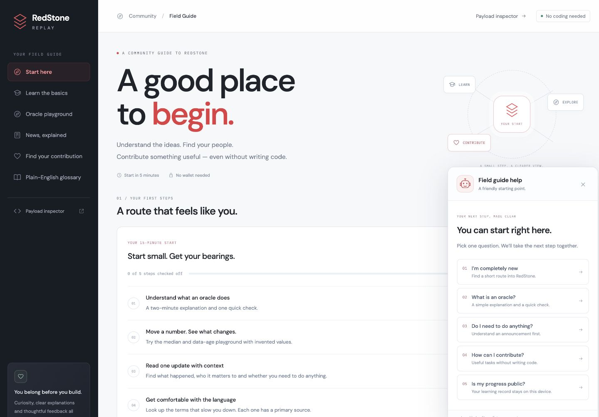

# RedStone Field Guide

[Open the Field Guide](https://redstone-replay.vercel.app/community/) · [Payload inspector](https://redstone-replay.vercel.app/) · [Contribute](../CONTRIBUTING.md)

A friendly starting point for community members who do not write code. This is an independent project by **VLS**, with original explanations and links to RedStone’s primary sources.

## Find your first route

1. Choose your goal: getting started, understanding the ideas or contributing.
2. Choose 5, 15 or 30 minutes. These are approximate reading and activity times.
3. Choose what you enjoy: learning, explaining or helping others.
4. Build your route. Open each activity and check it off when you are ready.

Your goal and time choose a short sequence of activities within that time budget; your interest prioritises contribution suggestions. **Change my route** lets you change your choices. Completed activities remain checked when they appear in another route. **Copy this route** shares the preferences, without sharing your completions.

This is a personal checklist. It does not submit tasks, synchronise Discord or Zealy roles, establish eligibility or award points.

## Learn by trying

- **Three short lessons:** what an oracle does, why observations can disagree and how to read an announcement. Each has a quick check, specific feedback and a primary source. A correct answer checks off that lesson on this device.
- **Oracle playground:** move three invented observations and inspect their median. Try one outlier, then old data. Values are illustrative, without a currency or live market connection. The 180-second rule is an example drawn from the default implementation; actual consumers may override it.
- **News, explained:** curated readings separate what happened, who it matters to and whether an action is needed. Publication and review dates are visible. Open the original article before relying on an explanation.
- **Plain-English glossary:** search terms or definitions and follow a primary source for more detail.

## Make something useful without code

The contribution cards suggest achievable activities: review a confusing step, explain one idea, propose a translation or ask a focused question. Suggestions are matched to your time and prioritised by interest.

Choose **Prepare a contribution**, select a listed official source and write a concrete observation of 20–1500 characters in your own words. The guide arranges this into a draft with a source and review checklist. Edit the result, then copy it when ready. Nothing is posted, sent to an AI service or submitted to RedStone automatically. Review the text and choose an appropriate place to share it yourself.

For feedback about this project, use [Community guide feedback](https://github.com/vlsss12/redstone-replay/issues/new/choose). Do not include private account information, secrets or unpublished security reports in a public issue.

## Ask the robot

The lower-right **Field guide help** button offers five starting questions:

- I’m completely new → route builder.
- What is an oracle? → first lesson or playground.
- Do I need to do anything? → announcement explainers.
- How can I contribute? → noncoding contribution ideas.
- Is my progress public? → privacy and sources.

This is local, predefined help, with direct actions. It is not an AI chat service. The payload inspector’s robot also links newcomers to the Field Guide.

## Privacy and reset

The key `redstone-field-guide:v1` contains only validated preferences, a plan flag and known completed-step identifiers in localStorage. Unknown or malformed entries are discarded. If storage is blocked, the current page remains usable and shows that progress is not saved.

Contribution notes and drafts stay in page memory. They are not stored in localStorage or shared route URLs and disappear on reload. Copying uses the browser clipboard. **Reset my progress** asks for confirmation and clears the guide’s preferences, checklist and open draft on this device; it does not change the inspector’s recent transaction history or any external account.

No wallet, sign-in or private keys are needed. External links follow the destination’s privacy practices. Google Fonts is used for typography; hosting providers may retain routine access logs.

## Editorial handbook

Content is curated in [`src/community-data.js`](../src/community-data.js), not fetched from a live news feed. Initial source review: **19 October 2026**.

For each new or revised explainer:

1. Read the original official article and verify its publication date and destination URL.
2. Write a short original summary. Separate the announcement, audience, interpretation and any action. Avoid investment instructions, reward promises or unsupported claims.
3. Store `published` and `reviewed` as real ISO dates (`YYYY-MM-DD`). A review older than 30 days, an invalid date or a future date shows **Source recheck due**. This badge signals editorial age; it does not automatically update content.
4. Explain scope precisely. A company information-security certificate does not certify this independent website. An integration announcement does not require a reader to buy an asset or claim a reward.
5. Link primary sources at the point of use. Preserve the difference between a teaching illustration and a deployed consumer’s rules.
6. Check desktop, mobile, quiz feedback, robot actions and local-only draft behaviour. Run `npm test` and `npm run build` for model or application changes.

There is no scheduled background curation. Maintainers must review sources and update the recorded date after actually checking them. Do not make old content look newly reviewed by changing a global date alone; update the affected card’s `reviewed` field.

## Implementation map

| File                     | Responsibility                                                                               |
| ------------------------ | -------------------------------------------------------------------------------------------- |
| `community/index.html`   | Dedicated `/community/` entry and metadata                                                   |
| `src/community-data.js`  | Lessons, sources, explainers, glossary and tasks                                             |
| `src/community-model.js` | Preference validation, time budgets, progress, simulation, review dates and draft validation |
| `src/community.js`       | UI, accessible dialogs, local persistence and interactions                                   |
| `src/community.css`      | Responsive Field Guide presentation                                                          |
| `src/guide.js`           | Shared contextual robot with page-specific topics                                            |
| `test/community.test.js` | Model, privacy boundaries and source consistency coverage                                    |

The community entry has no protocol-parser import. Vite builds it separately from the inspector and its isolated decoding worker.
